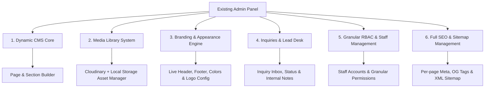

# AEROMARINE — COMPLETE WEBSITE & ADMIN CODEBASE AUDIT REPORT
**Target Domain**: [https://www.aeromarine.site](https://www.aeromarine.site)  
**Audit Executed**: 2026-11-24  
**Audit Scope**: Architecture, Frontend Components, Backend APIs, Database Schemas, Security Controls, Media Storage, and CMS Capabilities.

---

## 1. Executive Summary

AeroMarine is a full-stack maritime logistics, cargo container leasing, and capital investment web platform. The system operates on a modern MERN stack architecture (MongoDB, Express, React, Node.js) paired with Vite and Tailwind CSS.

While the existing system contains a functional operational desk for manual deposit verifications, withdrawal processing, and member account balances, **the website previously lacked a true Content Management System (CMS)**:
- User-facing pages (Home, About, Contact, Legal) contained hardcoded JSX copy and images.
- Page layouts, hero sections, statistics, and announcement tickers could not be edited by non-technical administrators without code changes.
- Website branding (logos, color accents, navigation menus, and footers) was hardcoded in static component trees.
- Inquiries submitted through the contact form were only routed through transactional emails without database persistence or an admin triage interface.
- There was no centralized Media Library for managing image assets, dimensions, or usage references.
- SEO configuration (meta tags, OpenGraph data, sitemaps) was static.

This audit documents the complete baseline of the existing platform and details the comprehensive architectural blueprint for transforming AeroMarine into a self-manageable, production-grade CMS ecosystem.

---

## 2. Existing Website Structure & Public Routes

### 2.1 Route Map & Mobile Shell Architecture
The client application currently implements a responsive layout architecture centered around a mobile frame (`MobileShell`) for customer interactions and a full-width desktop/drawer layout (`AdminLayout`) for operations:

| URL Path | Component | Current Data Source | CMS Editable? (Baseline) |
|---|---|---|---|
| `/` | `HomePage.jsx` | MongoDB (`/api/plans`) + Hardcoded JSX (Hero, Marquee, Quick Actions) | ❌ Partially hardcoded |
| `/about` | `AboutPage.jsx` | Static JSX (Mission, Fleet specs, 4-step workflow) | ❌ Completely hardcoded |
| `/containers` | `ContainersPage.jsx` | MongoDB (`/api/plans`) + Static headers | ❌ Partially hardcoded |
| `/contact` | `ContactPage.jsx` | Form submits to `/api/contact` | ❌ No DB storage / UI |
| `/terms`, `/privacy`, `/legal` | `LegalPage.jsx` | Static legal text | ❌ Completely hardcoded |
| `/income` | `IncomePage.jsx` | Dynamic user orders (`/api/orders/my`) | ✅ Transactional |
| `/task` | `WheelPage.jsx` | Dynamic spin API (`/api/task/spin`) | ✅ Transactional |
| `/team` | `TeamPage.jsx` | Dynamic referral hierarchy (`/api/team`) | ✅ Transactional |
| `/my` | `ProfilePage.jsx` | User wallet & profile (`/api/auth/me`) | ✅ User profile |
| `/recharge` | `RechargePage.jsx` | Dynamic banking coords + proof upload | ✅ Transactional |
| `/withdraw` | `WithdrawPage.jsx` | Dynamic balance checks + payout requests | ✅ Transactional |

---

## 3. Existing Admin Panel Functionality & Limitations

The administrative control center is protected by `AdminRoute` requiring JWT authentication and `role === 'admin' | 'owner'`:

### 3.1 Existing Admin Modules
1. **Admin Overview (`/admin`)**: Real-time overview of active users, total deposits, total payouts, fleet order counts, and system status.
2. **Deposit Requests (`/admin/deposits`)**: 1-click approvals/rejections of manual bank deposits with screenshot proof inspection and 3-tier commission automation (30%, 10%, 5%).
3. **Withdrawal Payouts (`/admin/withdrawals`)**: Review, IMPS reference assignment, approval, and balance reconciliation.
4. **User Management (`/admin/users`)**: Search members, adjust balances, add administrative audit notes, toggle active/suspended/blocked status.
5. **Container Fleet Plans (`/admin/plans`)**: CRUD operations on container plans (13.3% daily yield, duration, quota limits).
6. **Fleet Orders (`/admin/orders`)**: Audit trail of active container leases and yield collection states.
7. **Daily Earnings Engine (`/admin/earnings`)**: Batch execution of daily earnings calculations.
8. **Platform Settings (`/admin/settings`)**: Bank transfer coordinates, UPI ID, minimum deposit (₹750), minimum withdrawal (₹210).
9. **Security Audit Logs (`/admin/audit-logs`)**: Immutable logging of administrative actions with IP and timestamp tracing.

### 3.2 Missing CMS & Management Capabilities
- **No Page Builder**: Administrators cannot create new landing pages (e.g., `/promotions`, `/partner-network`, `/esg-policy`) or edit existing page routes.
- **No Section Management**: Hero banners, announcement tickers, statistics counters, and feature cards cannot be rearranged, hidden, or customized.
- **No Media Library**: Image uploads are confined to payment receipts and user avatars. No centralized repository exists for marketing assets, vessel photos, or brand logos.
- **No Website Appearance Controls**: Logo, favicon, primary/accent colors, and header/footer configurations cannot be modified without changing CSS or JSX.
- **No Inquiries Inbox**: Customer contact requests are emailed via Resend, leaving no internal audit record, search, filtering, or status workflow for port coordinators.
- **No SEO Editor**: Per-page meta titles, meta descriptions, canonical URLs, and OpenGraph social cards are completely inaccessible to administrators.
- **Incomplete Admin Staff Roles**: Roles exist in the Mongoose schema (`admin`, `owner`, `finance`, `support`, `operations`), but there is no admin UI to manage staff privileges or granular permissions.

---

## 4. Existing Database Models & Schemas

The backend uses Mongoose with strict schema typing:
- `User`: Handles identity, roles, permissions, phone, password hash, referral codes, and double-entry wallet counters.
- `Plan`: Container fleet catalog (pricing, daily income, duration, quotas, active state).
- `Order`: Active customer container leases with last claimed timestamps.
- `Recharge`: Manual deposit submissions with UTR numbers, screenshot URLs, and approval states.
- `Withdrawal`: Payout requests with bank IFSC / UPI addresses and audit statuses.
- `Record`: Financial transaction ledger entries (credits, debits, commissions).
- `SystemSetting`: Key-value configuration for financial limits and banking coordinates.
- `AuditLog`: Security logs for administrative actions.

---

## 5. Security & Data Integrity Audit

1. **Authentication & Session Management**:
   - Passwords hashed using `bcryptjs` with salt rounds.
   - JWT tokens with HMAC SHA-256 signatures and expiry.
   - Owner account `8427348239` is protected from deactivation/blocking.
2. **Access Control & RBAC**:
   - Backend routes guarded with `authenticate` and `requireAdmin`.
   - Double-processing guards protect against duplicate recharge approvals or concurrent double-withdrawals.
3. **Data Integrity & Ledgers**:
   - Double-entry Paise calculations prevent rounding drift.
   - Idempotency keys used across financial transactions.

---

## 6. Comprehensive Transformation Roadmap

To meet the complete CMS objectives without disrupting production data or business logic, the transformation is executed across 6 core pillars:

### Planned New Collections:
1. `Page`: Dynamic pages with URL slugs, status (`draft`, `published`), SEO metadata, and sections.
2. `MediaItem`: Uploaded media catalog with dimensions, MIME types, alt text, and usage references.
3. `Inquiry`: Contact requests with status, priority, admin notes, and coordinator assignment.
4. `NavigationMenu`: Header and footer menu structures with customizable links.

All changes will be verified against the 25 existing backend automated tests, accompanied by new CMS tests, mobile-responsiveness audits, and pushed to GitHub.
